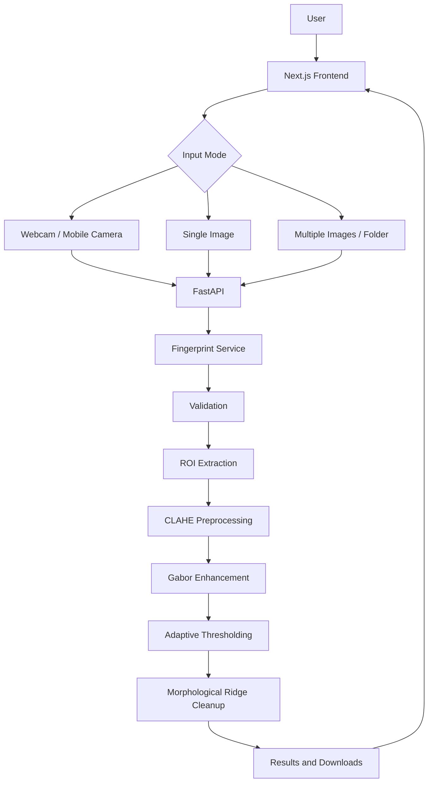

# Fingerprint Scanner AI

Fingerprint Scanner AI is a local full-stack computer vision workspace for fingerprint image acquisition and ridge enhancement. It offers a Next.js / React / TypeScript interface and a FastAPI backend that reuses this repository's OpenCV pipeline.

> This is a camera-based fingerprint image acquisition and enhancement system. A regular webcam is not a certified biometric scanner or authentication device.

## Features

- Browser camera capture with permission/error handling, camera selection, retake, and mobile-facing camera preference.
- Single image upload with drag/drop and JPG, JPEG, PNG, BMP, and WEBP support.
- Batch and folder input with independent per-file results and ZIP download.
- Original, ROI, normalized, Gabor enhanced, binary, and final output previews/downloads.
- Shared processing service for the HTTP API and CLI.
- Image quality indicators for dimensions, blur, contrast, brightness, and warnings.

## Stack and architecture

- Frontend: Next.js App Router, React, TypeScript, CSS design system.
- Backend: Python, FastAPI, Pydantic, OpenCV, NumPy.
- Existing algorithms retained: contour ROI extraction, CLAHE preprocessing, 16-angle Gabor response bank, adaptive thresholding, and morphological cleanup.



## Repository structure

```text
backend/app/       FastAPI routes, services, schemas, config, validation
backend/pipeline/  Preserved OpenCV processing stages
backend/utils/     Image I/O helpers
backend/tests/     API and CV pipeline tests
backend/docs/      Backend API, architecture, and pipeline documentation
backend/cli.py     CLI using the shared service
backend/requirements*.txt  Backend and test dependencies
frontend/src/      Next.js pages, reusable components, API client, types
backend/data/jobs/ Runtime processing artifacts, excluded from Git
```

## Local setup

Requires Python 3.10+ and Node.js 20.9+. The frontend uses Next.js 16.4 and React 19.3. No Docker is required.

### Backend

```bash
py -m venv .venv
.\.venv\Scripts\python.exe -m pip install -r backend/requirements.txt
.\.venv\Scripts\python.exe -m uvicorn backend.app.main:app --reload --port 8000
```

Health check: <http://localhost:8000/api/v1/health>. OpenAPI docs: <http://localhost:8000/docs>.

### Frontend

```bash
cd frontend
npm install
Copy-Item .env.example .env.local   # PowerShell; use cp on macOS/Linux
npm run dev
```

Open <http://localhost:3000>. Set `NEXT_PUBLIC_API_URL` in `frontend/.env.local` to the backend URL when it differs from `http://localhost:8000`. Browser camera access requires localhost or HTTPS and user permission.

### Environment variables

| Variable | Default | Purpose |
| --- | --- | --- |
| `NEXT_PUBLIC_API_URL` | `http://localhost:8000` | Frontend backend base URL |
| `CORS_ORIGINS` | `http://localhost:3000` | Comma-separated allowed browser origins |
| `MAX_UPLOAD_BYTES` | `12582912` | Per-image upload size limit |
| `FINGERPRINT_DATA_DIR` | `backend/data/jobs` | Runtime result storage root |

## API

See [backend/docs/api.md](backend/docs/api.md). Main endpoints:

- `GET /api/v1/health`
- `POST /api/v1/fingerprint/process` (`file`, optional `input_mode`)
- `POST /api/v1/fingerprint/validate` (`file`)
- `POST /api/v1/fingerprint/process-batch` (`files`, max 50)
- `GET /api/v1/fingerprint/result/{job_id}`
- `GET /api/v1/fingerprint/image/{job_id}/{stage}`
- `GET /api/v1/fingerprint/download/{job_id}/{stage}`

Responses use `{success, message, data}` on success and `{success, message, error_code}` for errors. Per-image upload limit is 12 MB. Batch failures are isolated per file.

## CLI

The CLI calls the same processing service used by FastAPI:

```bash
python -m backend.cli path/to/fingerprint.jpg
python -m backend.cli path/to/fingerprint-folder --output backend/data/outputs
```

Use any local image or folder path. CLI outputs are placed under `backend/data/outputs/` by default; use `--output` to choose another folder. API processing jobs are saved under `backend/data/jobs/`. These runtime folders are created on demand and ignored by Git.

## Testing and verification

Install test dependencies with `.\.venv\Scripts\python.exe -m pip install -r backend/requirements.txt -r backend/requirements-dev.txt` and run `.\.venv\Scripts\python.exe -m pytest backend/tests`. Frontend production build: `cd frontend && npm run build`. API smoke check: start Uvicorn, then request `GET /api/v1/health`.

## Limitations and future work

The current quality value is a heuristic based on blur, contrast, brightness, and dimensions; it is not a biometric quality certification. The algorithm enhances imagery and does not extract minutiae, classify, or match identities. Results are stored locally under `backend/data/jobs` without automatic retention cleanup; protect and clear this folder appropriately because it contains biometric imagery. Browser session history keeps up to 30 result references. A future quality model, orientation/frequency maps, minutiae extraction, authenticated deployment, and retention policy can be added behind the existing service layer.
